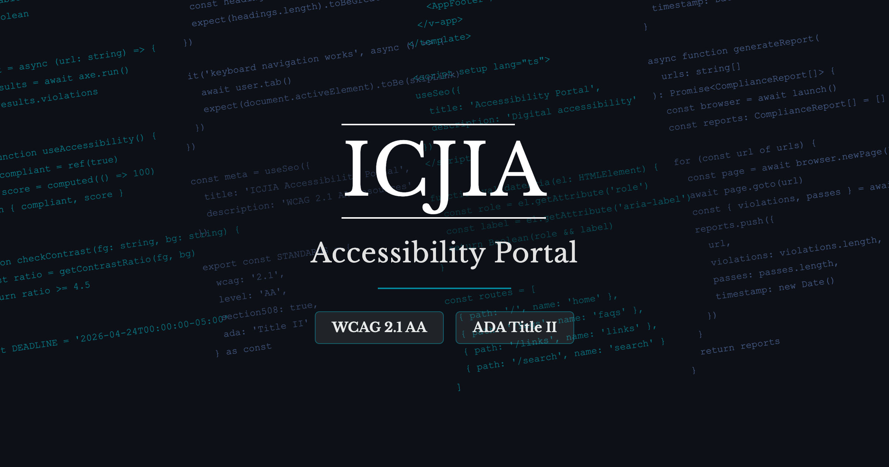

# ICJIA Accessibility Portal



A modern, accessible portal for the Illinois Criminal Justice Information Authority (ICJIA) designed to keep all accessibility information in one place to meet the **ADA Title II April 26, 2027 guideline**. This portal consolidates accessibility resources including comprehensive FAQs and curated links to ensure compliance and provide a centralized resource for accessibility information.

[](CHANGELOG.md)
[](https://www.w3.org/WAI/WCAG21/quickref/)
[](https://nuxt.com)
[](https://vuejs.org)
[](https://developer.chrome.com/docs/lighthouse/)
[](https://developer.chrome.com/docs/lighthouse/)
[](#ssr-hydration-fix-vuetify--nuxt)
[](CHANGELOG.md#110---2026-03-26)

> 📚 **For Developers**: See **[ARCHITECTURE_GUIDE.md](markdown-documentation/ARCHITECTURE_GUIDE.md)** for complete technical documentation, implementation details, challenges & solutions, and best practices.

## Purpose

This accessibility portal serves as a centralized hub for all accessibility-related information to ensure compliance with the **ADA Title II April 26, 2027 guideline**. The portal includes:

- **FAQs**: Comprehensive frequently asked questions about accessibility requirements, compliance, and implementation — rendered by a single shared `FaqBrowser` component on both the homepage and `/faqs`, so the two views always stay in parity
  - Dynamic countdown timer showing days until the April 26, 2027 deadline
  - "New" and "Updated on mm/dd/yyyy" chips distinguishing newly added questions (`{new:YYYY-MM-DD}`) from recently revised ones (`{updated:YYYY-MM-DD}`); both auto-expire after 21 days
  - Prominent review-status panel at the top ("Last reviewed" / "Last updated," driven by `lastReviewed`/`lastUpdated` frontmatter in `content/faqs.md`), signaling that content is periodically re-verified against official sources
  - Searchable accordion interface with proper ARIA attributes
  - **Printer-friendly version** at `/faqs-print` - All FAQs in a clean, printable format with proper structure for printing or saving as PDF. Internal links are styled as bold text (non-clickable), while external links remain functional.
  - **Screen Reader Testing (voicecap)** section — eight Q&As on ICJIA's free, open-source [voicecap](https://github.com/ICJIA/voicecap) tool, which runs the real NVDA screen reader through every page of a site and saves every word it says as transcripts, as the complement to code checkers such as axe and Pa11y
- **Links**: Curated collection of accessibility resources, tools, and related information organized by category

All accessibility information is organized in one place to facilitate easy access and ensure that ICJIA meets its accessibility obligations under ADA Title II.

## Quick Start

```bash
# Prerequisites: Node.js 22.23.4 (check .nvmrc)
nvm use

# Install dependencies
yarn install

# Start development server
yarn dev

# Visit http://localhost:3000
```

For production deployment:

```bash
# Generate static site
yarn generate

# Preview locally
yarn generate:serve

# Or deploy to Netlify automatically via Git push
```

## Tech Stack

### Core Framework

- **Nuxt 4** - Vue.js framework with static site generation and server-side rendering
- **Vue 3** - Progressive JavaScript framework with Composition API
- **TypeScript** - Type-safe JavaScript with enhanced IDE support

### UI & Styling

- **Vuetify 3** - Material Design component library with comprehensive accessibility support
- **Sass** - CSS preprocessor for maintainable stylesheets
- **Material Design Icons (MDI)** - Tree-shaken SVG icons via `@mdi/js` (only used icons are bundled)

### Content & Data

- **Nuxt Content 3** - File-based CMS with markdown support and query API
- **Zod** - TypeScript-first schema validation for content and configuration
- **better-sqlite3** - High-performance SQLite3 with synchronous API (used by Nuxt Content)

### Search & Discovery

- **Fuse.js** - Lightweight fuzzy-search library for client-side search with relevance ranking
- **search.config.json** - Externalized search configuration for easy tuning

### Development Tools

- **Vite** - Next-generation frontend build tool (via Nuxt)
- **Yarn** - Fast, reliable package manager
- **Playwright** - End-to-end testing and browser automation
- **axe-core** - Accessibility testing engine (WCAG 2.1 AA compliance)
- **TypeDoc** - API documentation generator from JSDoc comments
- **Vitest** - Unit and integration testing framework

### Analytics

- **Plausible Analytics** - Privacy-friendly, GDPR-compliant web analytics

### Deployment

- **Netlify** - Static site hosting with automatic deployments, custom headers, and CDN

## Features

### Accessibility (WCAG 2.1 AA Compliant)

- **100% Accessible** - All pages verified with automated accessibility audits using **axe-core** (zero violations)
- **Skip Navigation** - Skip link for keyboard users to jump to main content
  - Reusable `SkipLink` component used in all layouts
  - Positioned off-screen (`top: -100px`) until focused
  - High z-index (10000) ensures visibility
  - Includes smooth scroll and respects reduced motion preferences
  - 100% pass rate in accessibility audits (12/12 skip links working)
- **ARIA Support**:
  - Live regions for dynamic content (countdown timer with `aria-live="polite"`)
  - FAQ accordion uses Vuetify's `aria-expanded` disclosure pattern; trigger accessible name is the question text
  - `aria-current="page"` on active navigation items
  - Proper ARIA labels on all interactive elements
  - Decorative icons marked with `aria-hidden="true"`
- **Keyboard Navigation** - Fully keyboard navigable with visible focus indicators
- **Screen Reader Friendly** - Semantic HTML with proper heading hierarchy
- **Color Contrast** - WCAG AA compliant contrast ratios throughout
- **Reduced Motion** - Respects `prefers-reduced-motion` user preference

### Content Features

- **Dynamic Countdown Timer** - Shows days remaining until April 26, 2027 deadline (Chicago timezone)
  - All date calculations use Chicago timezone (America/Chicago) for Illinois state agencies
  - Uses explicit timezone offsets (CDT = UTC-5 in April, CST = UTC-6 in winter)
- **"New"/"Updated" Chip System** - Automatically displays and expires chips for newly-added or recently-updated FAQ entries
  - Add `{new:YYYY-MM-DD}` (star-prefixed "New on mm/dd/yyyy" chip) or `{updated:YYYY-MM-DD}` (Updated on mm/dd/yyyy chip) after the question heading in markdown
  - Chips auto-expire after 21 days (configurable); "Latest first" sorting ranks New above Updated on date ties
- **Responsive Markdown Tables** - Wide markdown tables scroll horizontally on small screens (instead of being clipped)
  - Subtle mobile hint: “Scroll horizontally to see more →” (visual-only, `aria-hidden`)
  - Keyboard-friendly: scroll container is focusable (`tabindex="0"`)
- **What's New** - A banner at the top of the countdown card shows the newest update; `/whats-new` lists every update, newest first
  - Entries live in `app/utils/whatsNew.ts` (`WHATS_NEW_ENTRIES`, newest first); add one with each release that changes what readers see
  - Static data, so the banner renders identically on the server and the client (no hydration mismatch or layout shift)
  - Linked from the banner ("See all updates") and from the footer
- **Printer-Friendly FAQs** - Dedicated printer-friendly version at `/faqs-print`
  - Complete FAQ content in a clean, printable format
  - Internal links styled as bold text (non-clickable) - section references don't work when printed
  - External links remain functional with URLs appended for accessibility
  - Table of contents for easy navigation
  - Clear section headings and numbered questions
  - Optimized for printing or saving as PDF
  - Includes last-updated date for reference
  - Fully accessible with discernible link text and table headers
  - Links display URLs for printed versions
- **Accessible FAQ Downloads** - Multiple accessible formats via Download dialog
  - **Word Document (.docx)** - H1–H4 heading hierarchy, 522 hyperlinks with visible text, `en-US` language declaration (WCAG 3.1.1), `<w:tblHeader/>` markup on every table header row (WCAG 1.3.1), complete document metadata (title/subject/creator/description/keywords)
  - **Markdown (.md)** - 122 headings with zero level skips, 37 tables with header separators, no bare URLs
  - **Plain Text (.txt)** - Universal format readable by any device or assistive technology, clear section separators
  - Download dialog has `role="dialog"`, `aria-modal`, and descriptive button labels
  - Download dialog explains each format and includes AI/LLM usage tips
  - Formats are generated at build time for static hosting, or on-demand during development
- **Markdown-based Content** - Easy content management via Nuxt Content
- **Dynamic Placeholders** - Auto-updating values like `{days_until_deadline}` in content
- **Fuzzy Search** - Instant client-side search with Fuse.js
  - Relevance-ranked results (best matches first)
  - Match highlighting in questions and answers
  - Relevance badges (Excellent/Good/Fair/Partial)
  - Configurable via `search.config.json`

### Design & Performance

- **Responsive Design** - Mobile-first approach with proper breakpoints
  - **Navigation**: Full nav buttons (Home, Print, Download, Check PDF, Links, Search) on screens ≥600px; hamburger menu on small/xs screens only (<600px)
  - Uses CSS media queries (not JS) to avoid SSR hydration mismatches
- **Dark Theme** - Modern dark theme by default using Vuetify Material Design
- **Static Site Generation** - Optimized for fast loading and Netlify deployment
- **Performance Optimized** - Proper caching headers and optimized assets
- **SEO Optimized** - Complete SEO setup with Open Graph, Twitter Cards, JSON-LD structured data, automated sitemap, and Google Search Console verification
- **Zero Hydration Errors** - All SSR hydration mismatches resolved (see [SSR Hydration Fix](#ssr-hydration-fix-vuetify--nuxt) below)

## Prerequisites

- **Node.js** 22.23.4 (see `.nvmrc` file)
- **Yarn** 1.22.22 or later

## Installation

```bash
# Install dependencies
yarn install
```

## Development

```bash
# Start development server (runs on http://localhost:3000)
yarn dev

# Run quick accessibility audit using axe-core (console output)
yarn audit:a11y

# Generate comprehensive accessibility report (HTML)
# Note: Requires a running server (dev, preview, or generate:serve)
yarn generate:accessibility
```

### Available Scripts

- `yarn dev` - Start development server with auto-reload
- `yarn build` - Build for production (SSR mode)
- `yarn generate` - Generate static site for deployment
- `yarn preview` - Preview production build locally (port 3000)
- `yarn generate:serve` - Generate and serve static site (port 5150)
- `yarn audit:a11y` - Quick accessibility check (console output)
- `yarn generate:routes` - Generate routes.json from pages/content
- `yarn generate:sitemap` - Generate sitemap.xml from routes

## Building

```bash
# Generate static site for production
yarn generate

# Build for production (SSR)
yarn build

# Preview generated static site locally
yarn preview

# Generate and serve static site on port 5150
yarn generate:serve
```

The build process will:

1. **Generate sitemap** - Automatically creates `sitemap.xml` with all public routes
2. **Generate static HTML files** - From Vue components
3. **Process markdown content** - From the `content/` directory
4. **Generate routes.json** - Lists all prerendered routes (used for sitemap generation)
5. **Regenerate sitemap** - Updates sitemap with discovered routes
6. **Optimize assets** - Creates production-ready files
7. **Copy public files** - Copies all files from `public/` directory (including `.well-known/` files)
8. **Output to `.output/public/`** - Directory ready for deployment

**Note**: The sitemap automatically excludes `/docs/` routes (documentation pages are public but not included in the sitemap for SEO purposes).

**Note**: The `.well-known/appspecific/com.chrome.devtools.json` file is included to prevent 404 errors when Chrome DevTools is open. This is a harmless Chrome DevTools request and the empty JSON file satisfies it.

## Deployment

This site is configured for deployment on Netlify with automatic builds and optimized performance.

### Deployment Configuration

- **Build command**: `npx playwright install chromium && yarn generate`
- **Publish directory**: `.output/public`
- **Node version**: 22.23.4 (specified in netlify.toml and .nvmrc)

**Build-time accessible document generation:**

- The build produces **accessible download files** (Word, Markdown, Plain Text) from `content/faqs.md`:
  - `ICJIA-Accessibility-FAQs.docx` - Word document with proper heading hierarchy
  - `ICJIA-Accessibility-FAQs.md` - Markdown with metadata header/footer
  - `ICJIA-Accessibility-FAQs.txt` - Plain text with ASCII separators for structure
- These replace the previously inaccessible PDF (Playwright print-to-PDF lacks PDF/UA tagging)
- During development (`yarn dev`), files are generated on-demand via server routes

### Security & Performance Headers

The `netlify.toml` file includes:

- **Security headers**:
  - Content-Security-Policy: Restricts script/style/font/image sources; blocks framing, base-uri, and form-action
  - Strict-Transport-Security: Enforces HTTPS with 1-year max-age, includeSubDomains, and preload
  - X-Frame-Options: DENY (prevents clickjacking)
  - X-Content-Type-Options: nosniff
  - X-XSS-Protection: 1; mode=block
  - Referrer-Policy: strict-origin-when-cross-origin
  - Permissions-Policy: Blocks geolocation, microphone, camera
- **Cache headers** for static assets (1 year cache for immutable files)

### Deployment Steps

#### Automatic Deployment (Recommended)

1. Push code to your Git repository (GitHub, GitLab, Bitbucket)
2. Connect the repository to Netlify
3. Netlify automatically detects the `netlify.toml` configuration
4. Site builds and deploys automatically on each push to main branch
5. Preview deployments created automatically for pull requests

#### Manual Deployment

```bash
# Generate the static site
yarn generate

# Deploy using Netlify CLI
netlify deploy --prod --dir=.output/public
```

### Build Process

The automated build process:

1. Ensures accessibility report placeholder exists
2. Generates `routes.json` from pages and content
3. Generates `sitemap.xml` from routes
4. Generates JSDoc/TypeDoc API documentation (`generate:jsdoc`, `yarn generate` only)
5. Builds/generates the Nuxt application
6. Regenerates routes.json with Nuxt-discovered routes
7. Updates sitemap with final routes
8. Generates accessible FAQ downloads (Word, Markdown, Plain Text)
9. Optimizes and outputs to `.output/public/`

**Note**: The sitemap automatically excludes `/docs/` routes (documentation pages are public but not indexed for SEO purposes).

## Project Structure

```
├── app/
│   ├── app.vue                 # Root app component
│   ├── layouts/
│   │   ├── default.vue         # Default layout with navbar and footer
│   │   └── print.vue           # Printer-friendly layout (no navbar/footer)
│   ├── pages/
│   │   ├── index.vue           # Home page with countdown timer and FAQs
│   │   ├── faqs.vue            # Dedicated FAQ page
│   │   ├── faqs-print.vue      # Printer-friendly FAQs page
│   │   ├── links.vue           # Accessibility links page
│   │   ├── search.vue          # Fuzzy search page with Fuse.js
│   │   └── whats-new.vue       # What's New: every update, newest first
│   ├── components/
│   │   ├── SkipLink.vue        # Skip to main content link
│   │   ├── AppNavbar.vue       # Navigation bar; responsive (hamburger <600px, full nav ≥600px); aria-current support
│   │   ├── AppFooter.vue       # Footer with copyright, links, and navigation
│   │   ├── CountdownTimer.vue  # Countdown timer with aria-live
│   │   ├── DownloadDialog.vue  # Accessible download format selection
│   │   ├── FaqBrowser.vue      # Shared FAQ view (homepage and /faqs)
│   │   ├── WhatsNewBanner.vue  # Newest What's New entry, at the top of the countdown card
│   │   └── FaqAccordion.vue    # FAQ accordion (Vuetify aria-expanded disclosure pattern)
│   ├── composables/
│   │   ├── useDeadlineCountdown.ts  # Composable for deadline timer
│   │   ├── useFaqCollapse.ts        # Composable for FAQ collapse state
│   │   ├── usePrintLinks.ts         # Composable for print-friendly link handling
│   │   ├── useSeo.ts                # Composable for SEO meta tags
│   │   ├── useSlugify.ts            # Composable for creating URL slugs (150-char limit)
│   │   └── useStructuredData.ts     # Composable for JSON-LD structured data
│   ├── plugins/
│   │   ├── content-links.client.ts  # Plugin to add target="_blank" to content links
│   │   ├── ensure-accessibility-report.server.ts  # Server plugin for report placeholder
│   │   ├── optimize-css.client.ts   # Client plugin for CSS optimization
│   │   ├── optimize-fonts.client.ts # Client plugin for font loading optimization
│   │   ├── suppress-vuetify-logs.client.ts  # Suppresses Vuetify console warnings (client)
│   │   └── suppress-vuetify-logs.server.ts  # Suppresses Vuetify console warnings (server)
│   ├── utils/
│   │   ├── faqTransform.ts     # FAQ AST transforms: New/Updated chips, "See also" cards, responsive tables
│   │   ├── icons.ts            # Tree-shaken @mdi/js SVG icons (28 icons, `svg:` prefixed)
│   │   └── whatsNew.ts         # What's New entries (newest first) and date helpers
│   ├── router.options.ts       # Custom router configuration
│   └── error.vue               # Error page component
├── content/
│   ├── faqs.md                 # FAQ content (with New/Updated chip support)
│   └── links.md                # Accessibility links content
├── public/
│   ├── favicon.svg             # Site favicon
│   ├── icjia-logo.png          # ICJIA logo
│   ├── robots.txt              # Robots.txt (allows indexing, disallows /docs/ and /_nuxt/)
│   ├── sitemap.xml             # Auto-generated sitemap (excludes /docs/ routes)
│   ├── .well-known/
│   │   └── appspecific/
│   │       └── com.chrome.devtools.json  # Chrome DevTools config (prevents 404)
│   └── docs/
│       ├── index.html          # Documentation portal index
│       ├── accessibility/
│       │   ├── index.html      # Accessibility audit report (generated)
│       │   ├── errors.json     # Accessibility errors data
│       │   └── violations.json # Accessibility violations data
│       ├── architecture/       # Architecture documentation page
│       ├── jsdoc/              # TypeDoc API documentation (generated)
│       └── tests/              # Test results report (generated by `yarn test`)
├── scripts/
│   ├── ensure-accessibility-report.js  # Ensures accessibility report placeholder exists
│   ├── extract-vue-scripts.js          # Extracts script blocks from Vue SFCs for TypeDoc
│   ├── generate-architecture-docs.js   # Auto-generates architecture documentation HTML
│   ├── generate-faq-docx.js            # Generates accessible Word document from FAQ content
│   ├── generate-faq-md.js              # Generates Markdown export from FAQ content
│   ├── generate-faq-txt.js             # Generates plain text export from FAQ content
│   ├── generate-icjia-logo.js          # ICJIA logo generation script
│   ├── generate-og-image.js            # OG image generator (serif font matching icjia-logo)
│   ├── generate-routes.js              # Routes generation script (scans pages and content)
│   └── generate-sitemap.js             # Sitemap generation script
├── audit-accessibility.js      # Comprehensive accessibility audit script - Tests WCAG 2.1 AA compliance using axe-core
├── markdown-documentation/     # Project documentation and audit results
│   ├── ARCHITECTURE_GUIDE.md       # Complete technical architecture guide (2900+ lines, with GitHub links)
│   ├── INDEX.md                    # Documentation index (all 23+ files organized by topic)
│   ├── PROJECT_REVIEW.md           # Comprehensive project review
│   └── (20+ other documentation files)
├── content.config.ts           # Nuxt Content configuration
├── netlify.toml                # Netlify deployment configuration
├── nuxt.config.ts              # Nuxt configuration
├── search.config.json          # Fuse.js search configuration (thresholds, weights, labels)
└── routes.json                 # Auto-generated routes list (from Nuxt build)
```

## Accessibility

This site is designed and tested to meet **WCAG 2.1 AA standards**. All pages have been verified with automated accessibility audits using **axe-core** (via @axe-core/playwright).

### Accessibility Features

- **Color Contrast**: Minimum 4.5:1 contrast ratio for normal text, 3:1 for large text
- **Keyboard Navigation**: Fully keyboard navigable interface with visible focus indicators
- **Screen Reader Support**:
  - ARIA live regions for dynamic content (countdown timer)
  - FAQ accordion uses Vuetify's `aria-expanded` disclosure pattern (question text is the button's accessible name)
  - Proper ARIA labels on all interactive elements
  - Decorative icons marked with aria-hidden
- **Semantic HTML**: Proper heading hierarchy and semantic structure
- **Skip Navigation**: Skip link for keyboard users to jump to main content
- **Reduced Motion**: Respects user's prefers-reduced-motion preference
- **Active Navigation**: aria-current="page" indicates current page in navigation

### Accessibility Testing

This project includes comprehensive accessibility testing tools powered by **axe-core**. The audit script is fully documented and can be reused for any website.

#### 📚 Complete Documentation

**For detailed information about the accessibility audit script, see:**

- **[ACCESSIBILITY_AUDIT_SCRIPT_GUIDE.md](markdown-documentation/ACCESSIBILITY_AUDIT_SCRIPT_GUIDE.md)** - Complete guide to the audit script (1355 lines with challenges & solutions)
  - Script architecture and design
  - Configuration options
  - Testing modes (development/production)
  - Viewport and theme testing
  - Rule configuration
  - Report generation
  - Modal windows
  - Reusing the script for other projects
  - Troubleshooting guide
  - **Includes GitHub links to all code snippets**

#### 1. Quick Console Audit (`yarn audit:a11y`)

A lightweight script that runs accessibility checks and outputs results to the console. Useful for quick checks during development.

```bash
yarn audit:a11y
```

**Features:**

- Automatically starts the development server
- Tests all pages for WCAG 2.1 AA compliance
- Displays violation reports in the console
- Exits with error code if violations are found (useful for CI/CD)

#### 2. Comprehensive HTML Report (`yarn generate:accessibility`)

A full-featured accessibility report generator that creates a detailed HTML report for all pages in the sitemap.

```bash
# First, start a server (choose one):
yarn dev              # Development server (port 3000)
yarn preview          # Preview server (port 3000)
yarn generate:serve  # Generated site server (port 5150)

# Then, in another terminal, generate the report:
yarn generate:accessibility
```

**Features:**

- **Uses sitemap.xml** - Automatically tests all pages listed in the sitemap
- **Comprehensive testing** - Full WCAG 2.1 AA compliance audit using axe-core
- **Multi-viewport testing** - Tests desktop, tablet, and mobile viewports
- **Multi-theme testing** - Tests light/dark themes (if configured)
- **Skip link verification** - Validates skip link functionality
- **Dynamic rule configuration** - Enable/disable rules via boolean values
- **HTML report generation** - Creates a beautiful, dark-themed HTML report
- **Clickable page links** - All page URLs in the report are clickable and open in new tabs
- **Detailed violation information** - Includes violation IDs, descriptions, impact levels, affected elements, and remediation guidance
- **Interactive modals** - Additional information about rules, tests, and configuration
- **Report location** - Generated at `/public/docs/accessibility/index.html` and accessible at `/docs/accessibility`
- **Documentation portal** - Report is accessible via the documentation portal at `/docs`

**Report Contents:**

- Summary statistics (total pages, passed/failed counts, total violations)
- Violation breakdown by impact level (critical, serious, moderate, minor)
- Per-page results with pass/fail status
- Detailed violation information for each page
- **Configured rules status** - Shows enabled/disabled rules with descriptions
- Information about axe-core and why it's a trusted accessibility testing tool
- Interactive modal windows for additional context

**Requirements:**

- A server must be running (dev, preview, or generate:serve)
- The script will automatically detect the running server on common ports (3000, 5150, 4173, 3003)
- If no server is detected, the script will provide clear instructions

**Accessing the Report:**

- After generation, view the report at: `http://localhost:[port]/docs/accessibility`
- Or access via the documentation portal: `http://localhost:[port]/docs`
- The report is also available in the footer navigation (Accessibility Report link)

#### 3. Script Configuration

The audit script (`audit-accessibility.js`) is highly configurable:

**Key Configuration Options:**

- **Environment**: Test against development (`localhost`) or production
- **Viewports**: Customize desktop, tablet, and mobile sizes
- **Themes**: Configure single or multiple theme testing
- **Rules**: Enable/disable specific axe-core rules via booleans
- **Skip Links**: Configure skip link detection selectors
- **Exclusions**: Exclude framework-specific wrapper elements

**📁 Script Location**: [`audit-accessibility.js`](https://github.com/ICJIA/icjia-accessibility-portal/blob/main/audit-accessibility.js)

**Configuration Section**: [Lines 23-299](https://github.com/ICJIA/icjia-accessibility-portal/blob/main/audit-accessibility.js#L23-L299)

#### 4. Reusing the Script

The audit script is designed to be reusable for any website:

1. **Copy the script** to your project root
2. **Install dependencies**: `npm install --save-dev puppeteer axe-core`
3. **Update configuration** (top of script) - Site info, URLs, paths
4. **Ensure sitemap.xml exists** - Script automatically reads URLs from sitemap
5. **Run the script**: `node audit-accessibility.js`

**For complete instructions, see**: [ACCESSIBILITY_AUDIT_SCRIPT_GUIDE.md - Reusing This Script](markdown-documentation/ACCESSIBILITY_AUDIT_SCRIPT_GUIDE.md#reusing-this-script)

## Best Practices (Reusable Patterns)

This project establishes several best practices that can be reused in other projects:

### 1. Timezone-Aware Date Handling

All date calculations use explicit timezone offsets for consistency across environments:

```typescript
// Chicago timezone (America/Chicago)
// CDT = UTC-5 (March-November), CST = UTC-6 (November-March)
const DEADLINE_DATE = new Date("2027-04-26T00:00:00-05:00").getTime();
```

**Why this matters:**

- Servers and clients may be in different timezones
- JavaScript's `new Date()` uses local timezone, which varies
- Explicit offsets ensure consistent behavior for Illinois state agencies

### 2. Accessible Document Downloads

Instead of inaccessible PDFs (Playwright/Puppeteer print-to-PDF lacks PDF/UA tagging), provide multiple accessible formats:

| Format                | Accessibility                                | Best For                 |
| --------------------- | -------------------------------------------- | ------------------------ |
| **Word (.docx)**      | Heading hierarchy, hyperlinks, tables        | Screen reader users      |
| **Markdown (.md)**    | Plain text readable, renders with formatting | Developers, AI/LLM input |
| **Plain Text (.txt)** | Universal, works on any device               | Maximum compatibility    |

**Implementation:**

- Generator scripts in `scripts/generate-faq-*.js`
- Server routes in `server/routes/` for development mode
- Static files generated during `yarn generate`
- User-friendly download dialog component

### 3. Comprehensive Test Documentation

All tests include detailed descriptions explaining their purpose:

```javascript
// In test/run-all-tests.js
const TEST_DESCRIPTIONS = {
  "should calculate days remaining correctly":
    "Verifies days until the April 26, 2027 deadline are calculated accurately " +
    "using Chicago timezone (America/Chicago, CDT = UTC-5). The calculation " +
    "divides milliseconds difference by (1000 * 60 * 60 * 24) and floors the result.",
  // ...
};
```

**Why this matters:**

- Tests serve as documentation
- New developers understand test purpose
- HTML test reports are self-explanatory
- AI/LLM can understand testing requirements

### 4. Expandable Test Reports

The HTML test report (`/docs/tests/`) includes:

- Expandable descriptions for each test
- Grouped tests by suite and file
- Pass/fail indicators with duration
- Direct links to source files

**Best practice:** Each test description should include:

- What is being tested
- Why it matters
- Expected behavior
- Technical implementation details

### 5. Avoiding Vuetify Utility Class Conflicts with Responsive CSS

When using CSS media queries to show/hide elements (e.g., responsive nav with hamburger on mobile), Vuetify utility classes can interfere:

```vue
<!-- ❌ Bad: d-flex uses display: flex !important, overrides display: none -->
<div class="mobile-nav d-flex">...</div>

<!-- ✅ Good: Control display entirely in your own CSS -->
<div class="mobile-nav">...</div>
```

```css
.mobile-nav { display: flex !important; align-items: center; }
@media (min-width: 600px) {
  .mobile-nav { display: none !important; }
}
```

**Key takeaway**: Vuetify's `d-flex`, `d-none`, etc. use `!important`. Omit them from elements you control with media queries and add `!important` to your own display rules.

---

## SSR Hydration Fix (Vuetify + Nuxt)

This section documents the diagnosis and resolution of persistent `"Hydration completed but contains mismatches"` console errors that appeared on every page of the application. These errors caused Lighthouse to flag the site under the `errors-in-console` audit, dropping Best Practices from 100% to 96%.

### The Problem

After server-side rendering (SSR), Vue 3 "hydrates" the server-rendered HTML by attaching client-side reactivity to the existing DOM. If the server-rendered HTML differs from what the client-side Vue app would render on its first pass, Vue logs a hydration mismatch warning. This site had **three distinct sources** of hydration mismatches.

### Root Cause 1: JavaScript-Based Responsive Navigation (`AppNavbar.vue`)

**Symptom**: Every page showed a hydration mismatch because the navigation bar rendered differently on the server vs. the client.

**Cause**: The `AppNavbar.vue` component used Vuetify's `useDisplay()` composable to conditionally render desktop or mobile navigation with `v-if`:

```typescript
// BEFORE (caused hydration mismatch)
const { mdAndUp } = useDisplay()
const showDesktopNav = computed(() => mdAndUp.value)
```

During SSR, there is no browser viewport, so `useDisplay()` returns default values (typically mobile). On the client, the actual viewport width is detected (typically desktop), causing a completely different DOM tree to render — triggering the mismatch.

**Fix**: Replaced JavaScript-based conditional rendering with **CSS media queries**. Both desktop and mobile navigation elements are always rendered in the HTML, but CSS controls their visibility:

```vue
<!-- Both always present in DOM - do NOT add d-flex; Vuetify's d-flex uses !important and overrides display:none -->
<div class="desktop-nav"><!-- desktop buttons --></div>
<div class="mobile-nav"><!-- hamburger menu --></div>

<style scoped>
.desktop-nav { display: none !important; }
.mobile-nav { display: flex !important; align-items: center; }
/* 600px = Vuetify "small" breakpoint. Hamburger only on small/xs screens. */
@media (min-width: 600px) {
  .desktop-nav { display: flex !important; align-items: center; }
  .mobile-nav { display: none !important; }
}
</style>
```

**Key takeaways**:
- In SSR applications, never use JavaScript-based viewport detection (`useDisplay()`, `window.innerWidth`, etc.) for conditional rendering with `v-if`. Use CSS media queries instead — the HTML stays identical between server and client.
- **Avoid Vuetify `d-flex` on responsive nav containers**: Vuetify's utility classes use `display: flex !important`, which overrides `display: none` in media queries. Omit `d-flex` from these divs and control display entirely in your own scoped CSS with `!important`.

### Root Cause 2: Disabled `useAsyncData` Cache on FAQs Page (`faqs.vue`)

**Symptom**: The FAQs page rendered the correct content from the markdown frontmatter on the server ("Common questions about accessibility") but on the client rendered the fallback text ("Find answers to common questions about web accessibility...").

**Cause**: The `useAsyncData` call had `getCachedData: () => undefined`, which explicitly disabled the SSR payload cache:

```typescript
// BEFORE (caused hydration mismatch on /faqs)
const { data: page } = await useAsyncData("faqs", () => {
  return queryCollection("faqs").first()
}, {
  getCachedData: () => undefined,  // <-- forces refetch, payload ignored
})
```

During SSR, the data fetched successfully and `page.value` had the content. But on the client, because `getCachedData` returned `undefined`, Nuxt discarded the SSR payload and initiated a fresh fetch. During the initial hydration render (before the fetch completes), `page.value` was `null`, so the template's fallback text rendered — a different string than what the server produced.

**Fix**: Removed the `getCachedData` option so the client uses the SSR payload during hydration:

```typescript
// AFTER (no mismatch)
const { data: page } = await useAsyncData("faqs", () => {
  return queryCollection("faqs").first()
})
```

**Key takeaway**: Never use `getCachedData: () => undefined` unless you understand that it will cause the client to discard the SSR payload, leading to `null` data during hydration. If you need fresh data, let the SSR payload hydrate first, then refetch with `refresh()` in `onMounted`.

### Root Cause 3: Vuetify SSR Layout Styles (Investigated, No Fix Needed)

**Symptom**: Vuetify's layout system produces SSR HTML with styles like `--v-layout-top:0px`, `transition:none !important`, `translateY(0%)`, and `opacity:NaN`.

**Diagnosis**: Deep comparison of SSR HTML vs. client DOM revealed these differences:

| Property | SSR Value | Client Value (after mount) |
| --- | --- | --- |
| `--v-layout-top` | `0px` | `64px` (measured app-bar height) |
| `transition` | `none !important` | _(removed)_ |
| `transform` | `translateY(0%)` | `translateY(0px)` |
| `opacity` (v-progress-linear) | `NaN` | `0` |

**Why no fix was needed**: Vue's hydration check compares the server-rendered DOM against the client's **initial VDOM render** (not the post-mount DOM). Vuetify's client code produces the same values as SSR during the initial render (`0px`, `transition:none !important`, `NaN`). The values above only change *after* `onMounted` runs — by which point hydration is complete.

**Critical insight about Nitro plugins**: An earlier attempt used a Nitro `render:html` plugin to "fix" the SSR HTML (changing `opacity:NaN` to `opacity:0`, adding `left:0px;width:calc(100% + 0px)`, etc.). This **introduced** mismatches rather than fixing them, because it changed the SSR output away from what Vue's client VDOM expected during hydration. The plugin was reverted to a no-op.

**Key takeaway**: When debugging SSR hydration mismatches, compare the SSR HTML against the client's **initial VDOM render** (what Vue would produce before any `onMounted` effects), not against the final post-mount DOM. Modifying SSR HTML to match the post-mount DOM will create mismatches, not fix them.

### Verification

After the fixes, all pages were verified clean using Puppeteer to capture console output:

```
/ ............. No hydration errors
/faqs ......... No hydration errors
/faqs-print ... No hydration errors
/links ........ No hydration errors
/search ....... No hydration errors
```

### Files Changed

| File | Change |
| --- | --- |
| `app/components/AppNavbar.vue` | Removed `d-flex` from nav container divs; added `!important` to display rules; breakpoint 600px (hamburger on small/xs only) |
| `app/pages/faqs.vue` | Removed `getCachedData: () => undefined` from `useAsyncData` |
| `app/pages/faqs.vue` | Wrapped `CountdownTimer` in `<ClientOnly>` with loading fallback |
| `app/pages/links.vue` | Wrapped `CountdownTimer` in `<ClientOnly>` with loading fallback |
| `server/plugins/fix-vuetify-ssr-nan.ts` | Reverted to no-op (documented why modifications cause mismatches) |

---

## Content Management

### Adding New FAQ Questions

1. Edit `content/faqs.md`
2. Add your question as an H3 heading (`###`)
3. Tag it on the next line (optional): `{new:YYYY-MM-DD}` for a brand-new question, or `{updated:YYYY-MM-DD}` for a revised one:

```markdown
### Your New Question Here?

{new:2026-08-13}

**Quick answer:** Your answer here...
```

The chip will:

- Display automatically for 21 days from the specified date
- Appear next to the question — a blue "★ New on mm/dd/yyyy" chip for `{new:}`, a green "Updated on mm/dd/yyyy" chip for `{updated:}`
- Rank New above Updated in the "Latest first" sort on date ties
- Auto-expire without any manual cleanup needed

### Adding Links

1. Edit `content/links.md`
2. Add your link using markdown syntax:

```markdown
- [Link Title](https://example.com) - Description of the link
```

Links automatically open in new tabs with proper accessibility attributes.

### Dynamic Placeholders

Content can include dynamic placeholders that auto-update:

- `{days_until_deadline}` - Shows days remaining until April 26, 2027

Example:

```markdown
There are {days_until_deadline} days until the deadline.
```

This automatically updates without rebuilding the site.

#### Why axe-core?

**axe-core** is the industry-standard accessibility testing engine used by major tools and organizations worldwide. Here's why it's as effective as commercial solutions like SiteImprove:

##### **Industry Standard & Widely Adopted**

- **Used by SiteImprove** - SiteImprove's automated testing incorporates axe-core rules
- **Used by major companies** - Trusted by Microsoft, Google, Facebook, and thousands of other organizations
- **Open source and transparent** - Unlike proprietary tools, you can inspect and understand exactly what's being tested

##### **Comprehensive WCAG Coverage**

- **WCAG 2.1 AA compliance** - Tests against all WCAG 2.1 Level A and AA success criteria
- **57+ accessibility rules** - Covers color contrast, ARIA usage, keyboard navigation, semantic HTML, and more
- **Regular updates** - Actively maintained with new rules added as WCAG standards evolve
- **Accurate results** - Low false positive rate compared to other automated tools

##### **Technical Advantages**

- **Real browser testing** - Uses Playwright to test in actual Chromium browsers (not just static analysis)
- **Dynamic content support** - Waits for JavaScript to execute and tests fully rendered pages
- **Detailed reporting** - Provides specific violation information with exact HTML elements and remediation guidance
- **CI/CD integration** - Can be run in automated pipelines to catch accessibility issues before deployment

##### **Comparison to Other Tools**

| Feature              | axe-core     | SiteImprove |
| -------------------- | ------------ | ----------- |
| WCAG 2.1 AA Coverage | ✅ Full      | ✅ Full     |
| Open Source          | ✅ Yes       | ❌ No       |
| Cost                 | ✅ Free      | ❌ Paid     |
| CI/CD Integration    | ✅ Excellent | ⚠️ Limited  |
| Detailed Reporting   | ✅ Yes       | ✅ Yes      |
| Real Browser Testing | ✅ Yes       | ✅ Yes      |

**Conclusion**: axe-core provides the same level of WCAG 2.1 AA compliance testing as commercial tools like SiteImprove. By using axe-core directly, we get comprehensive testing with full transparency, no licensing costs, and better integration with our development workflow.

#### Current Audit Status

✅ **All pages currently pass with zero violations detected and zero console errors.**

Latest audit results:

- **Total Pages Tested**: 5 (/, /faqs, /faqs-print, /links, /search)
- **WCAG 2.1 AA Violations**: 0
- **Accessibility Score**: 100%
- **Total Tests Run**: 1335
- **Skip Links**: 15/15 working
- **Console Errors**: 0 (all hydration mismatches resolved)
- **Last Audited**: March 2026

#### Lighthouse Scores

All pages score **100%** in Accessibility, Best Practices, Performance, and SEO:

| Page | Performance | Accessibility | Best Practices | SEO |
| -------------- | ----------- | ------------- | -------------- | --- |
| Home (`/`) | 100 | 100 | 100 | 100 |

> **Production scores** (April 2026): All four Lighthouse categories at 100 on desktop after switching to tree-shaken SVG icons and eliminating render-blocking font CSS.

The audit is run regularly during development to ensure ongoing compliance with WCAG 2.1 AA standards. Detailed audit results are available at `public/docs/accessibility/index.html`.

#### Sitemap Generation

The project includes automated sitemap generation that runs during build, generate, and dev processes:

- **Automatic generation** - Sitemap is created/updated automatically
- **Route discovery** - Uses `routes.json` (generated by Nuxt) as the primary source
- **Fallback scanning** - Scans `app/pages` and `content/` directories if routes.json isn't available
- **Excludes documentation** - Automatically excludes `/docs/` routes from the sitemap
- **Configurable domain** - Site domain is configurable in `scripts/generate-sitemap.js`

The sitemap is generated at `public/sitemap.xml` and includes all public pages with proper priority and change frequency settings.

## Documentation

### 📚 Prompts (for LLMs to build things)

This repo maintains **prompts** separately from retrospective documentation. A prompt tells an LLM **exactly what to build**.

- **Documentation Portal Prompt**: **[DOCUMENTATION_PORTAL_PROMPT.md](markdown-documentation/DOCUMENTATION_PORTAL_PROMPT.md)**
  - Builds the entire `/public/docs/*` portal (accessibility, tests, jsdoc, architecture)
- **Accessibility Audit Prompt**: **[ACCESSIBILITY_AUDIT_PROMPT.md](markdown-documentation/ACCESSIBILITY_AUDIT_PROMPT.md)**
  - Adds axe-core audits + `/docs/accessibility/` HTML/JSON outputs + placeholder strategy
- **Testing Reports Prompt**: **[TESTING_REPORTS_PROMPT.md](markdown-documentation/TESTING_REPORTS_PROMPT.md)**
  - Adds unit/nuxt/e2e test execution + `/docs/tests/` HTML report
- **Architecture Docs Prompt**: **[ARCHITECTURE_DOCS_PROMPT.md](markdown-documentation/ARCHITECTURE_DOCS_PROMPT.md)**
  - Generates `/docs/architecture/` HTML from an architecture markdown source

### 📚 Guides (documentation of what exists)

**Guides** document what’s already built in this repo, including rationale and troubleshooting.

**This guide is universal and works with any Vue 3, Nuxt 3/4, or Vuetify 3 project.**

### 📐 Complete Architecture Guide

For a comprehensive understanding of this application's architecture, implementation details, and best practices, see:

**[ARCHITECTURE_GUIDE.md](markdown-documentation/ARCHITECTURE_GUIDE.md)** - Complete guide covering:

- Project architecture and design decisions
- Content management strategy (markdown parsing, FAQ structure)
- Accessibility implementation (skip links, ARIA, focus management)
- Build and deployment process
- Challenges faced and solutions found
- Best practices and patterns
- Testing and validation approach
- Tips for replicating similar applications

**[📑 Documentation Index](markdown-documentation/INDEX.md)** - Quick reference to all documentation files organized by category

**This guide is essential reading for:**

- Developers new to the codebase
- LLMs working on this project
- Teams building similar accessibility-focused applications
- Anyone wanting to understand the full technical implementation

### Project Documentation

Comprehensive documentation is available in the `markdown-documentation/` folder:

#### 📐 Core (4 files)

- **[ARCHITECTURE_GUIDE.md](https://github.com/ICJIA/icjia-accessibility-portal/blob/main/markdown-documentation/ARCHITECTURE_GUIDE.md)** ⭐ - **Complete technical guide** (1300+ lines with 30+ GitHub links to source files) - **Start here!**
- **[DOCUMENTATION_PORTAL_PROMPT.md](https://github.com/ICJIA/icjia-accessibility-portal/blob/main/markdown-documentation/DOCUMENTATION_PORTAL_PROMPT.md)** 🆕 - **LLM-ready prompt** for creating documentation portals (accessibility, tests, JSDoc, architecture)
- **[INDEX.md](https://github.com/ICJIA/icjia-accessibility-portal/blob/main/markdown-documentation/INDEX.md)** - Documentation index and navigation hub
- **[PROJECT_REVIEW.md](https://github.com/ICJIA/icjia-accessibility-portal/blob/main/markdown-documentation/PROJECT_REVIEW.md)** - Complete project review with improvement suggestions

#### 🎨 Features & Guides (6 files)

- **[PRINTER_FRIENDLY_GUIDE.md](https://github.com/ICJIA/icjia-accessibility-portal/blob/main/markdown-documentation/PRINTER_FRIENDLY_GUIDE.md)** - Complete printer-friendly FAQ guide (overview, implementation, verification)
- **[ACCESSIBILITY_GUIDE.md](https://github.com/ICJIA/icjia-accessibility-portal/blob/main/markdown-documentation/ACCESSIBILITY_GUIDE.md)** - Complete accessibility documentation (audit results, skip links, testing)
- **[ACCESSIBILITY_AUDIT_SCRIPT_GUIDE.md](https://github.com/ICJIA/icjia-accessibility-portal/blob/main/markdown-documentation/ACCESSIBILITY_AUDIT_SCRIPT_GUIDE.md)** - Complete accessibility audit script guide (1355 lines with GitHub links) - Script architecture, configuration, testing modes, challenges & solutions, and reuse instructions
- **[FAQ_CONTENT_GUIDE.md](https://github.com/ICJIA/icjia-accessibility-portal/blob/main/markdown-documentation/FAQ_CONTENT_GUIDE.md)** - FAQ management (New/Updated chip system, content guidelines, references)
- **[SEO_GUIDE.md](https://github.com/ICJIA/icjia-accessibility-portal/blob/main/markdown-documentation/SEO_GUIDE.md)** - Complete SEO guide with implementation details and external action recommendations
- **[CONFIGURATION_ABSTRACTION.md](https://github.com/ICJIA/icjia-accessibility-portal/blob/main/markdown-documentation/CONFIGURATION_ABSTRACTION.md)** - Configuration management guide

#### 📅 History & Updates (3 files)

- **[CONTENT_MAINTENANCE_HISTORY.md](https://github.com/ICJIA/icjia-accessibility-portal/blob/main/markdown-documentation/CONTENT_MAINTENANCE_HISTORY.md)** - Chronological log of content fixes and improvements
- **[FEATURE_UPDATES.md](https://github.com/ICJIA/icjia-accessibility-portal/blob/main/markdown-documentation/FEATURE_UPDATES.md)** - Log of major feature additions and enhancements
- **[DOCUMENTATION_HISTORY.md](https://github.com/ICJIA/icjia-accessibility-portal/blob/main/markdown-documentation/DOCUMENTATION_HISTORY.md)** - Meta-log of documentation updates

#### 🧪 Testing (1 file)

- **[test/E2E_TEST_PLAN.md](https://github.com/ICJIA/icjia-accessibility-portal/blob/main/test/E2E_TEST_PLAN.md)** - Comprehensive E2E test implementation plan (coverage, strategy, examples)
- **[test/README.md](https://github.com/ICJIA/icjia-accessibility-portal/blob/main/test/README.md)** - Complete test suite documentation (unit, Nuxt, E2E plans)

**Total**: 22 documentation files organized by category

### Live Documentation Portal

The application includes a built-in documentation portal at `/docs/` with:

- **Accessibility Reports** (`/docs/accessibility/`) - Automated accessibility audit results
- **Test Reports** (`/docs/tests/`) - Visual HTML test results (generated by `yarn test`)
- **Portal Index** (`/docs/`) - Central hub for all documentation

Access the documentation portal:

- **How it works / how to extend it**: [`markdown-documentation/DOCUMENTATION_PORTAL.md`](markdown-documentation/DOCUMENTATION_PORTAL.md)

- Development: `http://localhost:3000/docs` (or `http://localhost:3000/docs/index.html`)
- Production: `https://your-domain.com/docs` (or `https://your-domain.com/docs/index.html`)

**Note for Nuxt static prerendering**: If your build crawler treats `/docs/` as an app route, prefer linking to the explicit static file `/docs/index.html` from within the app.

### Audit Reports

Generate and view comprehensive audit reports:

```bash
# Start server first
yarn dev  # or yarn generate:serve

# Generate accessibility report
yarn generate:accessibility
```

Reports include:

- Summary statistics
- Detailed violation information
- Remediation guidance
- Historical comparisons
- Element-level details

## Security Audit (Red/Blue Team)

A comprehensive red/blue team security assessment was conducted on **March 26, 2026**. Full details are documented in [CHANGELOG.md](CHANGELOG.md#110---2026-03-26).

### Overall Risk Rating: LOW

This is a statically-generated documentation site with no server-side processing, no authentication, no database, and no user uploads — a minimal attack surface by design.

### Red Team Findings Summary

| Severity | Count | Description |
|----------|-------|-------------|
| **Critical** | 0 | No critical vulnerabilities in application code |
| **High** | 3 | Transitive dev dependency issues (basic-ftp, devalue, axios) — not in production runtime |
| **Medium** | 2 | Missing CSP and HSTS headers — **Fixed** |
| **Low** | 4 | Conditional v-html usage, build-time dep issues — monitored |

### Blue Team Strengths

- Zero dangerous patterns (`eval`, `Function`, `innerHTML` with user data)
- Proper XSS escaping in search with `escapeHtml()` before `v-html`
- External links secured with `rel="noopener noreferrer"`
- Zod schema validation on all content frontmatter
- No exposed secrets (`.env` gitignored, no API keys in source)
- Static site generation eliminates server-side attack vectors
- Privacy-first analytics (self-hosted Plausible, no cookies)

### Remediations Applied

- **Content-Security-Policy** header added — restricts all resource loading to `'self'` and `plausible.icjia.cloud`
- **Strict-Transport-Security** header added — enforces HTTPS with 1-year max-age and preload

### Accessibility Audit (axe-core)

Full axe-core assessment conducted on **March 26, 2026**:

| Metric | Result |
|--------|--------|
| **Total Pages Tested** | 5 (/, /faqs, /faqs-print, /links, /search) |
| **Viewports Tested** | 3 (Desktop 1920x1080, Tablet 768x1024, Mobile 375x812) |
| **Total Checks Run** | 1,335 |
| **Violations Found** | **0** |
| **Skip Links Verified** | 15/15 |
| **WCAG 2.1 AA Compliance** | 100% |

## Changelog

See [CHANGELOG.md](CHANGELOG.md) for a complete history of all releases, milestones, and security audit documentation.

## Project Status

**Current Status**: ✅ Production Ready

### Completed Features

- ✅ All pages pass WCAG 2.1 AA compliance (zero violations)
- ✅ Fully responsive design (mobile, tablet, desktop)
- ✅ Dark theme with proper contrast ratios
- ✅ Static site generation optimized for Netlify
- ✅ Comprehensive accessibility features:
  - Skip navigation link
  - ARIA live regions for dynamic content
  - Proper focus management
  - Keyboard navigation support
  - Screen reader optimized
- ✅ SEO optimized with automated sitemap generation
- ✅ "New"/"Updated" chip system for FAQ questions (21-day window)
- ✅ Dynamic countdown timer (April 26, 2027 deadline) on `/`, `/faqs`, and `/links`
- ✅ What's New banner (top of the countdown card) and `/whats-new` archive
- ✅ Automated accessibility audits
- ✅ Documentation portal with audit reports
- ✅ Comprehensive JSDoc documentation throughout all JavaScript/TypeScript files

### Recent Updates (November 2026)

- **v1.4.2 — documentation brought current** (2026-11-06): README, CLAUDE.md, the Architecture Guide, and the docs index checked against the code after v1.4.0 and v1.4.1 (What's New, Node 22.23.4, current dependency versions, project trees, build pipeline, Netlify config, 249 tests). The published architecture page (`/docs/architecture/`) is regenerated (it still said April 24, 2026) and now passes axe-core with 0 violations, best practices included: its light theme had low-contrast links and header, links in text were told apart by color alone, code blocks weren't keyboard-scrollable, there was no `<main>` landmark, and `target="_blank"` links were broken by the generator's italic rule
- **v1.4.1 — dependency refresh** (2026-11-06): one combined update replaces 26 stale Dependabot PRs and takes open Dependabot alerts from 317 to 7 (the rest are build-time or dev-only tools with no non-major fix). Nuxt 4.6.4, Vue 3.5.45, Vuetify 3.13.7, Nuxt Content 3.16.2, Vitest 4.1.12, Fuse.js 7.5.0; dev majors @nuxt/test-utils 4, happy-dom 21, netlify-cli 27. **Node is now 22.23.4** (Nuxt 4.6 requires 22.22.3 or later): `.nvmrc`, `netlify.toml`
- **v1.4.0 — What's New banner and page** (2026-11-06): the deadline-extension notice at the top of the countdown card is replaced by a **What's New** banner showing the newest update (a shorter version on `/faqs` and `/links`), with a link to the new **`/whats-new`** page, which lists every update newest first, back to the portal's launch on December 15, 2025. "What's New" is also the first link in the footer. Entries live in `app/utils/whatsNew.ts`
- **v1.3.9 — November 2026 review; voicecap across the FAQ** (2026-11-06): every Q&A checked for stale content (legal status re-verified: § 35.200 dates, no new DOJ or HHS web rule, no ruling in NFB v. DOJ, no IITAA change announced); "as of" status dates moved to November 6, 2026; an adversarial accuracy pass then corrected about 30 small overstatements (legal wording, the ICJIA grievance procedure, sourcing, tool details); the voicecap section matches voicecap 0.24.1 (voice page, five published ICJIA sites); voicecap is now pointed to from the coordinator, deadline, enforcement, executive, WCAG 2.2-vs-2.1, PDF-checker, and third-party-tools answers and the glossary; the stale 2021 Canva VPAT link is replaced with Canva's accessibility statement

### Earlier Updates (October 2026)

- **v1.3.8 — voicecap wording; ICJIA's federal funding sourced** (2026-10-26): dropped "forms" from the voicecap section's list of manual checks; the Section 504 answer now cites USAspending.gov for ICJIA's DOJ funding and notes that HHS's rule also covers HHS money passed through another organization (45 CFR § 84.10)
- **v1.3.7 — ICJIA's ADA grievance procedure, MCAR, headcount** (2026-10-26): the complaints answer now reflects ICJIA's formal ADA grievance procedure (4 Ill. Adm. Code Part 150, in effect since 1993); "MCAR" (no source uses it for an accessibility document) is removed and the VPAT question renamed; ICJIA's headcount is cited from the State's FY2027 budget; two passages trimmed from the voicecap section
- **v1.3.6 — ICJIA coordinator status confirmed** (2026-10-26): ICJIA still hasn't designated an agency accessibility coordinator. The FAQ's three dated status notes now read October 26, 2026 (they were dated March and May 2026)
- **v1.3.5 — voicecap section + October 2026 accuracy review** (2026-10-26):
  - **NEW**: "Screen Reader Testing (voicecap)" FAQ section — eight Q&As covering what voicecap is and why ICJIA built it, how it differs from axe/Pa11y/Lighthouse/SiteImprove (mapped to WCAG 2.1 success criteria), how it works, measured time savings, accuracy and verification, its limits (and why a clean report isn't a compliance claim), setup on Windows, and the test-fix-compare-share workflow
  - Cross-linked from the website-testing, web-developer, manager, SiteImprove, external-audit, overlay, good-faith-progress, sign-off, and maintain-compliance answers; added to the Keyword Index, Glossary, Free Testing Tools table, and the Links page
  - Adversarial accuracy review of all 120 Q&As against primary sources (eCFR, Federal Register, ILGA, Illinois DoIT, W3C, and vendor documentation). It corrected the federal rule's reach to internal content, IITAA 2.1's scope, the § 35.201(b) document test, the archive criteria, and dozens of product instructions; see [CHANGELOG.md](CHANGELOG.md). All 229 external citation URLs were re-checked and all 290 internal links verified
  - Footer "Print" link: accessible name now contains its visible label (WCAG 2.5.3 Label in Name, flagged by axe-core 4.14)
  - Plain-text FAQ download: fenced code examples now come through verbatim (they were garbled by stray backticks)

### Recent Updates (March 2026)

- **v1.1.0 — Security Hardening** (2026-03-26):
  - Red/blue team security audit completed — see [CHANGELOG.md](CHANGELOG.md#110---2026-03-26) for full report
  - Added Content-Security-Policy (CSP) header
  - Added Strict-Transport-Security (HSTS) header with preload
  - Full axe-core accessibility re-assessment: 0 violations, 1,335 checks across all pages/viewports
  - Created CHANGELOG.md with complete project milestone history
- **NEW**: FAQ question about ICJIA's drag-and-drop PDF accessibility checker at https://audit.icjia.app
  - 9 accessibility checks, free and open source, browser-based with no installation
  - Cross-referenced from "How do I make a PDF accessible?", "How do I test my website?", and "Do all documents need to be accessible?"
  - Added to Free Testing Tools glossary table
- **UPDATE**: README updated to reflect current dependency versions, project structure, and documentation file counts

### Updates (February 2026)

- **FIX**: Responsive navigation hamburger menu
  - Hamburger now appears only on small/xs screens (<600px); full nav buttons on all larger screens
  - Root cause: Vuetify's `d-flex` utility class uses `display: flex !important`, which overrode scoped `display: none` in our CSS media queries -- making the hamburger visible at all screen sizes
  - Solution: Removed `d-flex` from nav container divs and added `!important` to our own display rules in the scoped CSS
- **FIX**: SSR Hydration Mismatch Resolution (see [detailed section below](#ssr-hydration-fix-vuetify--nuxt))
  - Eliminated all "Hydration completed but contains mismatches" console errors across every page
  - Refactored `AppNavbar.vue` from JavaScript-based responsive rendering (`useDisplay()`) to CSS media queries
  - Fixed `useAsyncData` cache invalidation on FAQs page that caused server/client content divergence
  - Documented Vuetify SSR layout behavior (why `opacity:NaN` and `transition:none !important` are intentional)
  - All pages now score **100% Best Practices** in Lighthouse with zero console errors
- **FIX**: CountdownTimer on internal pages (`/faqs`, `/links`) wrapped in `<ClientOnly>` to prevent hydration mismatch
- **FIX**: Accessibility label mismatch on logo link (`label-content-name-mismatch`)
- **FIX**: Heading order on search page (`h3` changed to `h2` to maintain proper hierarchy)
- **FIX**: Switched from `@mdi/font` (50KB+ CSS) to `@mdi/js` tree-shaken SVG icons (only 27 used icons bundled)
- **FIX**: Added `srcset` for responsive logo images on print page (`image-size-responsive`)

### Updates (January 2026)

- **NEW**: Documentation Portal Prompt (`DOCUMENTATION_PORTAL_PROMPT.md`)
  - Step-by-step LLM-ready prompt for creating documentation portals
  - Works with any Vue/Nuxt/Vuetify project
  - Complete code snippets with GitHub links
- **NEW**: Accessible FAQ Downloads (replacing inaccessible PDF)
  - Word (.docx), Markdown (.md), and Plain Text (.txt) formats
  - Responsive download dialog with fullscreen mobile mode
  - LLM/AI usage tips for Markdown and Plain Text
- **NEW**: Chicago Timezone Handling
  - All date calculations use explicit Chicago timezone offsets
  - Ensures consistent display for Illinois state agencies
- **NEW**: Expanded Test Descriptions
  - All 220 tests include detailed explanations in HTML report
  - Tests serve as living documentation
- **NEW**: JSDoc/TypeDoc API documentation (`/docs/jsdoc/`)
  - Comprehensive documentation for all composables, utilities, and plugins
  - Type definitions and interfaces
  - Source links to GitHub
  - Generated automatically during static site build
- **NEW**: Fuzzy search functionality (`/search`) with Fuse.js
  - Relevance-ranked results (best matches first)
  - Match highlighting in questions and answers
  - Relevance badges (Excellent/Good/Fair/Partial)
  - Externalized configuration (`search.config.json`)
  - Comprehensive test suite (57 new tests)
- **NEW**: Printer-friendly FAQs page (`/faqs-print`) for easy printing and offline reference
  - All FAQ content in clean, printable format
  - Table of contents with question counts
  - Professional business document styling
  - Optimized for print and PDF export
  - Includes clickable links (screen) and reference URLs (print)
  - Last-updated date for document tracking
  - Uses custom print layout (no navbar/footer)
  - 100% accessible (skip link, proper semantics)
- Enhanced FAQ system with auto-expiring "Updated" badges
- Improved accessibility with comprehensive ARIA support
- Implemented dynamic content placeholders
- Added comprehensive project documentation
- Optimized CSS and performance
- Enhanced content management system
- Navigation improvements (**Print** + **Download** links added to navbar and footer)
- **Footer refactor** - Modern, centered design with links for **Print**, **Download**, **Documentation**, **Accessibility**, and GitHub. Fully responsive and accessible with proper ARIA labels.
- **SEO enhancements** - Complete SEO implementation with Open Graph, Twitter Cards, JSON-LD structured data (GovernmentOrganization, WebSite, FAQPage with 100+ questions, BreadcrumbList), Google Search Console verification, and comprehensive sitemap

### Version Information

**Version**: 1.4.2
**Last Updated**: November 6, 2026

**Core Dependencies**:

- Node.js: 22.23.4
- Nuxt: 4.6.4+
- Vue: 3.5.45+
- Vuetify: 3.13.7+
- Nuxt Content: 3.16.2+

**Testing Tools**:

- **Vitest** - Fast unit and integration testing
- **@nuxt/test-utils** - Nuxt-specific testing utilities
- **@vue/test-utils** - Vue component testing
- **axe-core**: 4.14.0+ (accessibility testing)
- Playwright: 1.65.0+ (browser automation)

### Project Review & Improvement Roadmap

**Last Updated**: January 1, 2026

A comprehensive project review is available with detailed status, completed improvements, and prioritized recommendations:

**[📋 PROJECT_REVIEW.md](markdown-documentation/PROJECT_REVIEW.md)** - Complete project review including:

- ✅ **Recently Completed Improvements** - SEO enhancements, accessibility features, printer-friendly page, audit script, dependency updates, comprehensive documentation
- 🎯 **High Priority Remaining** - TypeScript type safety, image optimization, performance optimizations
- 🔧 **Medium Priority** - Code deduplication, testing expansion, error handling enhancements
- 🎨 **Low Priority** - UX enhancements, PWA support, i18n
- 📊 **Priority Matrix** - Visual guide to improvement priorities with status indicators
- 📈 **Project Health Metrics** - Current accessibility compliance, dependency status, documentation coverage
- 🚀 **Next Steps Timeline** - Immediate, short-term, medium-term, and long-term roadmap

**Current Status**: ✅ **Production Ready** - 100% WCAG 2.1 AA Compliant (0 Violations)

The review includes detailed implementation notes, file references, and GitHub links to all relevant code.

### Future Enhancements

Quick reference of potential improvements (see [PROJECT_REVIEW.md](markdown-documentation/PROJECT_REVIEW.md) for complete details):

**High Priority**:

- TypeScript type improvements (replace `any` types)
- Image optimization (WebP format, lazy loading)
- Performance optimizations (font preloading, resource hints)

**Medium Priority**:

- Code deduplication (extract shared logic)
- Testing expansion (unit, integration, E2E)
- Error handling enhancements

**Low Priority**:

- PWA support for offline access
- Internationalization (i18n)
- Advanced analytics

## Contributing

### Development Workflow

1. **Fork & Clone** the repository
2. **Create a feature branch**: `git checkout -b feature/your-feature-name`
3. **Make changes** and test thoroughly
4. **Run tests**: `yarn test` to run all tests and generate reports
5. **Run audits**: `yarn audit:a11y` to ensure accessibility compliance
6. **Commit changes**: Use clear, descriptive commit messages
7. **Push to your fork**: `git push origin feature/your-feature-name`
8. **Submit a Pull Request** with detailed description

### Code Standards

- **Accessibility First**: All changes must maintain WCAG 2.1 AA compliance
- **TypeScript**: Use proper types, avoid `any` when possible
- **Vue 3 Composition API**: Use `<script setup>` syntax
- **Semantic HTML**: Use proper HTML5 semantic elements
- **ARIA Labels**: Include proper ARIA attributes for interactive elements
- **JSDoc Documentation**: All JavaScript/TypeScript files include comprehensive JSDoc comments
  - File-level `@fileoverview` tags with descriptions
  - Function documentation with `@param`, `@returns`, and `@example` tags
  - Type annotations for constants and variables
  - See existing files in `app/composables/`, `app/utils/`, `app/plugins/`, and `scripts/` for examples
- **Testing**: Run `yarn test` to ensure all tests pass before submitting
- **Accessibility**: Run `yarn audit:a11y` to ensure accessibility compliance

### Content Guidelines

When adding or updating content:

- Use clear, plain language (avoid jargon)
- Maintain consistent tone (professional but approachable)
- Check spelling and grammar
- Use markdown best practices
- Test with screen readers when possible

### Accessibility Testing

Before submitting changes:

```bash
# Run quick accessibility audit
yarn audit:a11y

# Generate full accessibility report
yarn dev  # in one terminal
yarn generate:accessibility  # in another terminal
```

Ensure zero violations on all pages.

## Support & Resources

### Getting Help

- **Issues**: Report bugs or request features via GitHub Issues
- **Documentation**: See `markdown-documentation/` folder
- **WCAG Guidelines**: [Web Content Accessibility Guidelines (WCAG) 2.1](https://www.w3.org/WAI/WCAG21/quickref/)
- **ADA Title II**: [ADA.gov Guidance](https://www.ada.gov/)

### Useful Links

- **Nuxt 4 Documentation**: https://nuxt.com/docs
- **Vuetify 3 Documentation**: https://vuetifyjs.com/
- **axe-core Rules**: https://github.com/dequelabs/axe-core/blob/develop/doc/rule-descriptions.md
- **WCAG Quick Reference**: https://www.w3.org/WAI/WCAG21/quickref/

## License

MIT License

Copyright (c) 2026 Illinois Criminal Justice Information Authority

Permission is hereby granted, free of charge, to any person obtaining a copy of this software and associated documentation files (the "Software"), to deal in the Software without restriction, including without limitation the rights to use, copy, modify, merge, publish, distribute, sublicense, and/or sell copies of the Software, and to permit persons to whom the Software is furnished to do so, subject to the following conditions:

The above copyright notice and this permission notice shall be included in all copies or substantial portions of the Software.

THE SOFTWARE IS PROVIDED "AS IS", WITHOUT WARRANTY OF ANY KIND, EXPRESS OR IMPLIED, INCLUDING BUT NOT LIMITED TO THE WARRANTIES OF MERCHANTABILITY, FITNESS FOR A PARTICULAR PURPOSE AND NONINFRINGEMENT. IN NO EVENT SHALL THE AUTHORS OR COPYRIGHT HOLDERS BE LIABLE FOR ANY CLAIM, DAMAGES OR OTHER LIABILITY, WHETHER IN AN ACTION OF CONTRACT, TORT OR OTHERWISE, ARISING FROM, OUT OF OR IN CONNECTION WITH THE SOFTWARE OR THE USE OR OTHER DEALINGS IN THE SOFTWARE.

See the [LICENSE](LICENSE) file for the complete license text.

---

**Built with accessibility in mind for the Illinois Criminal Justice Information Authority**

For questions or support, please open an issue on GitHub.
